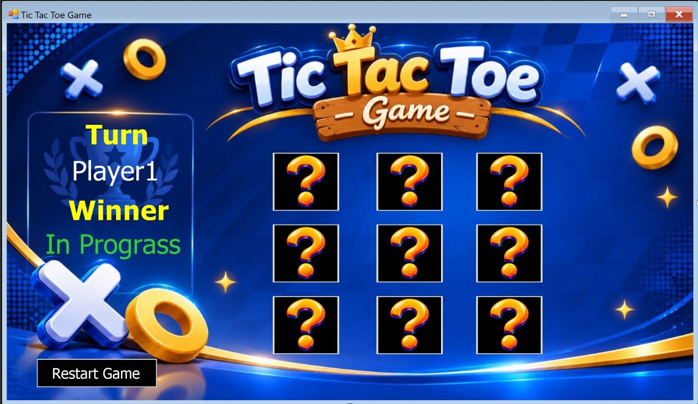
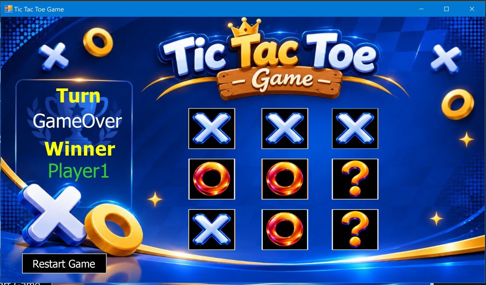

<div align="center">

# ❌⭕ Tic-Tac-Toe Game

**A classic two-player desktop game developed using C# and Windows Forms, featuring an interactive 3×3 game board, automatic winner detection, and turn management.**


[Overview](#overview) • [Screenshots](#screenshots) • [Features](#features) • [Technologies](#technologies) • [Getting Started](#getting-started) • [Technical Highlights](#technical-highlights) • [Author](#author)

---

</div>

## Overview

**Tic-Tac-Toe** is a classic two-player game where players take turns placing `X` and `O` marks on a 3×3 grid. The application manages player turns, validates moves, checks all winning combinations, and determines the game result.

Players can also restart the game to clear the board and begin a new round.

---

## Screenshots

|            Game Board            |            Game Result            |
| :------------------------------: | :-------------------------------: |
|  |  |

---

## Features

- **Two-Player Mode:** Play against another player on the same device.
- **Interactive Game Board:** A 3×3 grid where players place `X` or `O` marks.
- **Turn Management:** Automatically switches between Player 1 (`X`) and Player 2 (`O`) after each valid move.
- **Winner Detection:** Checks all 8 winning combinations (3 rows, 3 columns, and 2 diagonals).
- **Draw Detection:** Checks whether all 9 cells are occupied without a detected winner.
- **Move Validation:** Prevents selecting an already occupied cell and displays a warning message.
- **Game Status Display:** Shows the current turn and the game result through status labels and a message dialog.
- **Restart Functionality:** Resets the board and game state to start a new round.

---

## Technologies

| Technology        | Usage                                         |
| :---------------- | :-------------------------------------------- |
| **C#**            | Game logic, player management, and game rules |
| **Windows Forms** | Desktop graphical user interface (GUI)        |
| **Visual Studio** | Integrated Development Environment (IDE)      |

---

## Getting Started

### Prerequisites

- Windows OS
- Visual Studio with the **.NET Desktop Development** workload
- The .NET Framework or .NET version targeted by the project

### Installation & Running

1. Clone the repository:

```bash
git clone https://github.com/Yousef-Aljaberi/Tic-Tac-Toe-Game.git
```

2. Open the solution file (`.sln`) in **Visual Studio**.
3. Build the solution using `Ctrl + Shift + B`.
4. Press `F5` to run the game.

---

## Technical Highlights

- **Enums (`enPlayer`, `enWinner`):** Representing player turns and possible game outcomes, including Player 1, Player 2, Draw, and InProgress.
- **Structs (`stGameStatus`):** Grouping game information such as the winner, game-over state, and number of moves (`PlayCount`).
- **State Tracking with `Tag`:** Using the `Tag` property to track the state of each game cell (`"?"`, `"X"`, or `"O"`).
- **LINQ Control Iteration:** Using `OfType<Button>()` to iterate through form buttons when resetting the board, while excluding the Restart button.
- **Code Organization:** Separating winner verification (`CheckValues`, `CheckWinner`), player turn handling (`ChangePhoto`), and board resetting (`RestartGame`) into dedicated methods.
- **Event-Driven Programming:** Handling user interactions through Windows Forms events.

---

## Author

<div align="center">

**Yousif Aljaberi**

<a href="https://www.linkedin.com/in/yousif-aljaberi-004278408/" target="_blank">
  
</a>
&nbsp;
<a href="https://github.com/Yousef-Aljaberi" target="_blank">
  
</a>

</div>
